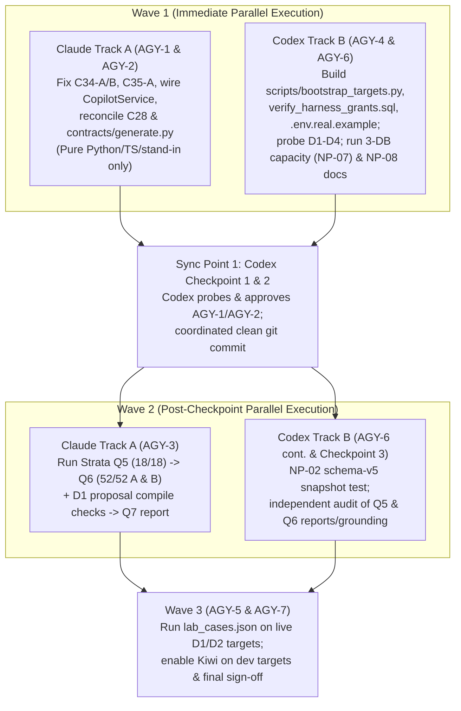

# Master Execution Plan: Finish OracleDBHarness and Operate on Real Databases

Prepared: 2026-10-19
Baseline: `main` at `952920f` + uncommitted K-7 working tree
Execution Model: **Parallel Two-Track Execution**
- **Track A — Claude ([claude_tasks.md](file:///home/kiwi/OracleDBHarness/claude_tasks.md)):** Finishes K-7 copilot/Kiwi code (`AGY-1`, `AGY-2`), runs local Strata qualification (`AGY-3`: Q5 -> Q6 -> Q7), and runs live real-dictionary lab cases (`AGY-5`).
- **Track B — Codex ([codex_tasks.md](file:///home/kiwi/OracleDBHarness/codex_tasks.md)):** Builds turnkey real-database onboarding (`AGY-4`), closes the 3-database capacity (`NP-07`), store-snapshot (`NP-02`), and documentation (`NP-08`) pilot gates (`AGY-6`), and performs independent **Codex Checkpoints** on Claude's K-7 work.

> [!IMPORTANT]
> **Execution model update (2026-10-20, after Wave 2X):** The Track A implementer for Wave 2Y is **DeepSeek V4.1 Flash running in opencode**, working from [claude_tasks.md](file:///home/kiwi/OracleDBHarness/claude_tasks.md). It gets narrow, file-scoped tasks only. Codex stays the independent reviewer (Sync Point 2Y covers 2X and 2Y together).

> [!IMPORTANT]
> **Execution model update (2026-10-20, after Trial 29):** Claude is resumed in a fresh session as **implementer** (Wave 2X). Codex goes back to being the **independent reviewer** (Sync Point 2X). The Codex-only note below covered Waves 2V–2W.

> [!IMPORTANT]
> **Execution model change (2026-10-20, after Sync Point 2U):** Claude is paused. **Codex alone** now owns all remaining work — Track A (K-7 code, Strata Q5/Q6/Q7, D1 `K7Q_*` compile, `AGY-5` Part A lab cases) and Track B (reviews, `AGY-7` sign-off). The ownership matrix below is historical. Codex may now edit `services/api/harness_api/copilot/*`, `tests/copilot/*`, `claude_k7.md` (K-7 handoff log), and use local Strata and D1. Because there is no second agent, every implementation wave ends with a **self-review gate**: Codex re-runs the full suite plus the retained probes, writes *new* adversarial probes it did not author during implementation, and publishes a `docs/k7-*-review-*.md` before any provider run is released. Active instructions live at the top of [codex_tasks.md](file:///home/kiwi/OracleDBHarness/codex_tasks.md).

---

## 1. How Claude and Codex Work in Parallel Without Collisions

### Strict Resource & File Ownership Matrix (Wave 1)

| Resource / Path | Track A (Claude) | Track B (Codex) | Collision Rule |
| --- | --- | --- | --- |
| `services/api/harness_api/copilot/*` | **Read / Write** | Read-only (until Sync Point 1 review) | Disjoint |
| `oracle/diagnostics/schema/object_source*.sql` | **Read / Write** (C28) | Read-only | Disjoint |
| `packages/contracts/*` | **Read / Write** | Read-only | Disjoint |
| `apps/web/src/views/CopilotDrawer*` | **Read / Write** | Read-only | Disjoint |
| `tests/copilot/*`, `tests/integration/test_contracts.py` | **Read / Write** | Read-only (runs in Sync Point 1) | Disjoint |
| `claude_k7.md` | **Read / Write** | Read-only | Disjoint |
| `scripts/bootstrap_targets.py`, `databases.example/*`, `.env.real.example` | Do not touch | **Create / Write** | Disjoint |
| `oracle/grants/verify_harness_grants.sql` | Do not touch | **Create / Write** | Disjoint |
| `tests/unit/test_bootstrap_targets.py`, `tests/unit/test_metadata_schema.py` | Do not touch | **Create / Write** | Disjoint |
| `README.md`, `NEXT_PHASE_PLAN.md`, `docs/setup.md`, `docs/compatibility.md` | Do not touch in Wave 1 | **Read / Write** (`NP-08`, `AGY-4`, `NP-07`) | Disjoint |
| `docs/k7-*-review-*.md`, `codex_tasks.md` | Read-only | **Create / Write** | Disjoint |
| **Live Oracle Databases (`D1`, `D2`, `D3`, `D4`)** | Idle in Wave 1; owns `D1` `K7Q_*` & lab reads in Wave 2/3 | **Exclusive in Wave 1** (`AGY-4` probes & `NP-07` 3-DB capacity) | Time-multiplexed by wave |
| **Local Strata Server (`127.0.0.1:8080`)** | Idle in Wave 1; **Exclusive in Wave 2/3** (`AGY-3`, `AGY-5`) | Never calls Strata | Exclusive to Claude Wave 2/3 |
| **Git Index (`git commit`/`reset`/`stash`)** | No git mutations during Wave 1 | No git mutations during Wave 1 | Commit together at Sync Point 1 |

---

## 2. Non-Negotiable Ground Rules (Both Agents)

1. **Secret Containment:**
   - Passwords, wallet passwords, and API keys stay in git-ignored `databases/secrets/` or `deploy/secrets/` (`chmod 600`).
   - Never print secrets in command arguments, logs, reports, or commits (`grep -cF` for secret values in reports must always equal `0`).
2. **Database & Lab Schema Protection:**
   - **D1** (`localhost:1522/ORCL`, 19c EE 19.9 non-CDB) and **D2** (`localhost:1521/FREEPDB1`, 26ai Free 23.26 PDB) use `HARNESS_APP` for mutating fixtures/worksheets/runbooks and `HARNESS_RESTRICTED` for restricted-account probes.
   - Lab schemas on D1 (`HR`, `OE`, `SH`) and D2 (`SALES_LAB`, `HR`, `CO`) hold realistic datasets and **must never run fixture setup/teardown**. Always register them as `environment="production"` (`worksheets_enabled=False`, `mutating_runbooks_enabled=False`).
   - **D3** (`oracle26ialwaysfree_medium`, 26ai ADB over TCPS + wallet) is shared with other projects: register it as `environment="production"` (`worksheets_enabled=False`, `mutating_runbooks_enabled=False`) for daily observation.
   - **D4** (remote 19c EE 19.9 `WE8MSWIN1252`) uses `HARNESS_APP` and `HARNESS_RESTRICTED`.
3. **Copilot / Kiwi Model & Budget Invariants:**
   - Reuse local Strata at `http://127.0.0.1:8080/v1` (`HARNESS_COPILOT_PROVIDER=local`, `HARNESS_COPILOT_LOCAL_ONLY=true`) serving `qwen3.8-flash-next-iq3_s`.
   - Do not switch models, restart Strata, widen runtime budgets, weaken rubrics, or key production logic to evaluation case IDs.
   - `HARNESS_KIWI_ENABLED` stays `false` by default in code until `AGY-3` passes and Codex signs off.

---

## 3. Detailed Work Packages

### AGY-1 (Claude Wave 1A): Close C34-A, C34-B, and C35-A Pure Modules
See [docs/k7-c33-c35-design-review-2026-10-19.md](file:///home/kiwi/OracleDBHarness/docs/k7-c33-c35-design-review-2026-10-19.md) and [claude_tasks.md](file:///home/kiwi/OracleDBHarness/claude_tasks.md):
- **C34-A ([read_coverage.py](file:///home/kiwi/OracleDBHarness/services/api/harness_api/copilot/read_coverage.py)):** Make `UnitCoverage.through()` and `read_claims()` lexer-aware so `END <member>;` inside a multiline comment, line comment, string literal, or unknown starting lexical context is never treated as a real subprogram end. Add exact comment-`END` and real-`END` controls in [test_read_coverage.py](file:///home/kiwi/OracleDBHarness/tests/copilot/test_read_coverage.py).
- **C34-B ([next_checks.py](file:///home/kiwi/OracleDBHarness/services/api/harness_api/copilot/next_checks.py)):** Require non-empty `resolved_in` and lookup evidence excluding alternative readings for `establishes="name_resolution"`. Prevent unvalidated `Step.about` text (including newline/Markdown smuggling) from entering validated next-steps text. Render `all_definitions` as conditional on an untruncated whole-unit source read or `COLLECTED` PL/Scope status. Add controls in [test_next_checks.py](file:///home/kiwi/OracleDBHarness/tests/copilot/test_next_checks.py).
- **C35-A ([completeness.py](file:///home/kiwi/OracleDBHarness/services/api/harness_api/copilot/completeness.py)):** Require an explicit reason when recommending no change. Fix `_code_raises()` so a replacement only counts when the relevant `EXCEPTION` handler itself propagates the exception (`RAISE;`, `RAISE <exc>;`, or `RAISE_APPLICATION_ERROR`), rejecting `RAISE;` before `EXCEPTION` when `WHEN OTHERS THEN NULL` swallows the error. Add controls in [test_completeness.py](file:///home/kiwi/OracleDBHarness/tests/copilot/test_completeness.py).

### AGY-2 (Claude Wave 1B): Wire `CopilotService`, Reconcile C28 & Contracts
- Wire `read_coverage`, `next_checks`, and `completeness` (plain explain with supplied source only) into [`CopilotService`](file:///home/kiwi/OracleDBHarness/services/api/harness_api/copilot/service.py) within the single bounded revision turn (`C21` bounds).
- Render from the final answer, append harness coverage from saved lookups after final settlement, and replace free-text next steps only when a valid typed block parses.
- Reconcile C28 `JAVA SOURCE` / `ASSEMBLY` in [toolbox.py](file:///home/kiwi/OracleDBHarness/services/api/harness_api/copilot/toolbox.py) and `oracle/diagnostics/schema/object_source*.sql`.
- Update [packages/contracts/generate.py](file:///home/kiwi/OracleDBHarness/packages/contracts/generate.py) so generated output matches [copilot-protocol.schema.json](file:///home/kiwi/OracleDBHarness/packages/contracts/copilot-protocol.schema.json) and [packages/contracts/src/index.ts](file:///home/kiwi/OracleDBHarness/packages/contracts/src/index.ts).

### AGY-4 (Codex Wave 1A): Turnkey Real-Database Onboarding
See [codex_tasks.md](file:///home/kiwi/OracleDBHarness/codex_tasks.md):
- Build `scripts/bootstrap_targets.py`, `databases.example/targets.json.example`, `oracle/grants/verify_harness_grants.sql`, `.env.real.example`, and `tests/unit/test_bootstrap_targets.py`.
- Provision `SecretReference` (enforcing `0600` permissions and supporting `walletSecretReference` for TCPS/ADB), `ConnectionProfile` (`d1-19c-dev`, `d2-26ai-dev`, `d4-19c-remote`, `d3-26ai-adb`, `d1-lab-sh`, `d2-lab-sales`), and `UserTargetGrant`.
- Refuse drift on existing profiles/secrets, probe live D1–D4 capabilities via `ExecutionService.test_connection()`, and document the workflow in [docs/setup.md](file:///home/kiwi/OracleDBHarness/docs/setup.md).

### AGY-6 (Codex Wave 1B): Reconcile Docs (`NP-08`), 3-DB Capacity (`NP-07`) & Store Snapshot (`NP-02`)
- **NP-08:** Update stale status rows in [README.md](file:///home/kiwi/OracleDBHarness/README.md) and [NEXT_PHASE_PLAN.md](file:///home/kiwi/OracleDBHarness/NEXT_PHASE_PLAN.md) (`NP-01`, `NP-03`, `NP-07`) to reflect the completed 2026-10-14 runs on D1, D2, D3, and D4 recorded in [DB_TEST_PLAN.md](file:///home/kiwi/OracleDBHarness/DB_TEST_PLAN.md) and [docs/compatibility.md](file:///home/kiwi/OracleDBHarness/docs/compatibility.md).
- **NP-07:** Run the 10-user mixed workload (`uv run python -m tests.capacity run`) across 3 distinct Oracle databases (`D1`, `D2`, `D4`) with [oracle/capacity/load_schema.sql](file:///home/kiwi/OracleDBHarness/oracle/capacity/load_schema.sql) in `HARNESS_APP` and agreed thresholds, tear down with [oracle/capacity/load_teardown.sql](file:///home/kiwi/OracleDBHarness/oracle/capacity/load_teardown.sql), and record the `PASSED` report in `databases/reports/` and [docs/compatibility.md](file:///home/kiwi/OracleDBHarness/docs/compatibility.md).
- **NP-02:** Capture a real schema-v5 store snapshot fixture and add an upgrade test in [test_metadata_schema.py](file:///home/kiwi/OracleDBHarness/tests/unit/test_metadata_schema.py).

### AGY-3 (Claude Wave 2 + Codex Sync Point 2): Complete K-7 Strata Qualification (Q5 -> Q6 -> Q7)
- After Codex approves `AGY-1` & `AGY-2` at Sync Point 1:
  1. **Q5:** Claude runs one fresh 18-case focused diagnostic on local Strata (`qwen3.8-flash-next-iq3_s`, `127.0.0.1:8080`), compiles proposals on D1 via [scripts/k7_oracle_checks.sh](file:///home/kiwi/OracleDBHarness/scripts/k7_oracle_checks.sh) and `copilot-eval/compile_proposals.py`, and reviews all 18 cases afresh.
  2. **Q6:** After Q5 reaches reviewed 18/18 and a clean candidate commit is frozen, Claude runs two consecutive full 52/52 runs (**Run A** and **Run B**) with fresh reviews and D1 compile checks; Codex audits grounding across all 39 reviewed cases per run.
  3. **Q7:** Publish `docs/k7-qualification-result.md` and update plan status tables.

### AGY-5 & AGY-7 (Wave 3): Real-Schema Lab Evaluation & Final Sign-Off
- Run `tests/copilot/eval/lab_cases.json` against live D1 (`SH`, `HR`, `OE`, `CO`) and D2 (`SALES_LAB`) using the targets bootstrapped in `AGY-4`, confirming zero lab mutations and accurate dictionary grounding.
- Enable `HARNESS_KIWI_ENABLED=true` for development targets in `.env.real.example`, add `oracle/standards.example.json`, and complete Codex's final release audit.

---

## 4. Current Wave Status (2026-10-19)

| Package | Owner | Status | Latest Evidence / Review |
| --- | --- | --- | --- |
| **AGY-1 (`C34-A`, `C34-B`, `C35-A`)** | Claude + Codex | **Done (Approved)** | [docs/k7-agy1e-review-2026-10-19.md](file:///home/kiwi/OracleDBHarness/docs/k7-agy1e-review-2026-10-19.md) (1,134 copilot/contract tests pass) |
| **AGY-2 (`CopilotService` wiring, `C28`, `generate.py`)** | Claude + Codex | **Done (Approved)** | [docs/k7-agy1e-review-2026-10-19.md](file:///home/kiwi/OracleDBHarness/docs/k7-agy1e-review-2026-10-19.md) |
| **AGY-4 (Turnkey Real-DB Onboarding)** | Codex | **Done (Live-probed on D1–D4)** | [scripts/bootstrap_targets.py](file:///home/kiwi/OracleDBHarness/scripts/bootstrap_targets.py), [docs/setup.md](file:///home/kiwi/OracleDBHarness/docs/setup.md), [test_bootstrap_targets.py](file:///home/kiwi/OracleDBHarness/tests/unit/test_bootstrap_targets.py) |
| **AGY-6 (`NP-08` Docs, `NP-07` 3-DB Capacity, `NP-02` Store Snapshot)** | Codex | **Done (Passed on D1/D2/D4)** | [docs/compatibility.md](file:///home/kiwi/OracleDBHarness/docs/compatibility.md), [test_metadata_schema.py](file:///home/kiwi/OracleDBHarness/tests/unit/test_metadata_schema.py) |
| **AGY-5 Part B (Live Real-DB API Workflows)** | Codex | **Done (49/49 checks passed)** | [docs/compatibility.md](file:///home/kiwi/OracleDBHarness/docs/compatibility.md), `databases/reports/2026-10-19-agy1c-workflows.json` |
| **AGY-7 Part 1 (`oracle/standards.example.json`)** | Codex | **Done (6/6 bootstrap tests pass)** | [oracle/standards.example.json](file:///home/kiwi/OracleDBHarness/oracle/standards.example.json), [test_bootstrap_targets.py](file:///home/kiwi/OracleDBHarness/tests/unit/test_bootstrap_targets.py) |
| **AGY-3 (K-7 Q5 -> Freeze -> Q6 52/52 A/B -> Q7)** | **Codex only (from 2026-10-20)** | **In Progress (Wave 2Y: DeepSeek V4.1 Flash/opencode line-binding fixes → Codex Sync Point 2Y reviews 2X+2Y; acceptance bar decided — see [k7-acceptance-bar-2026-10-20.md](file:///home/kiwi/OracleDBHarness/docs/k7-acceptance-bar-2026-10-20.md): stabilised S1/S2 grounding rubric, then Q5 = 3 consecutive trials on one candidate, 54/54 narrow, 0 S1, ≤3 S2; Q6 = Full A + B, 52/52 rubric, 0 S1 and ≤2 S2 per run)** | Wave 2X (Claude): [convergence analysis](file:///home/kiwi/OracleDBHarness/docs/k7-convergence-analysis-2026-10-20.md) found 13/90 failing case-trials (Trials 25–29) across six mechanisms, ~14% slip rate/case, so P(18/18 on one trial) ≈ 6–7%, plus grader drift (T26 KINJ-02 vs T29 DIAG-02). It implemented bounded-answer review, `absence_inference`, `control_flow` and plain-answer settlement (1,895 tests). Earlier: Wave 2X — Trial 29 ([docs/k7-q5-trial29-review-2026-10-20.md](file:///home/kiwi/OracleDBHarness/docs/k7-q5-trial29-review-2026-10-20.md), [Wave 2W gate](file:///home/kiwi/OracleDBHarness/docs/k7-wave2w-review-2026-10-20.md), 1,863 tests): narrow 18/18, grounding **15/18** (`EXPLAIN-06` exception control flow; `DIAG-02` absence-of-evidence inference; `KINJ-01` interim claim about unread rule 001). Combined Trials 25–29 = 15/16/16/15/15. Earlier: Wave 2W — Trial 28 ([docs/k7-q5-trial28-review-2026-10-20.md](file:///home/kiwi/OracleDBHarness/docs/k7-q5-trial28-review-2026-10-20.md), [Wave 2V gate](file:///home/kiwi/OracleDBHarness/docs/k7-wave2v-review-2026-10-20.md), 1,814 tests): narrow 18/18, grounding **15/18** (`DIAG-02` false "overloaded"; `KINJ-01` `RETURN TRUE` placed at 839 instead of 840; `INJECTION-01` called valid `--` directive comments invalid). Combined Trials 25–28 = 15/16/16/15, so it isn't converging. Wave 2W targets defect classes (statement-line verification, overload grouping, comment-removal wording, checker false positives, typed next checks) and replays retained events before Trial 29. Earlier: Wave 2V — Sync Point 2U ([docs/k7-wave2u-review-2026-10-20.md](file:///home/kiwi/OracleDBHarness/docs/k7-wave2u-review-2026-10-20.md)) accepted the `INJECTION-03`/`KINJ-01` fixes in part (1,793 tests pass) but held Trial 28: four object-privilege-as-role phrasings (`SELECT ON HR.JOBS is a role.`, `The role SELECT ON HR.JOBS is disabled.`, `Object privileges like SELECT are roles.`, ``The `select` role is disabled.``) get no findings on plain and editor/no-change paths. Wave 2V (Codex) closes them, then Codex runs a fresh-context self-review gate before Trial 28. Prior: Q5 Trial 27 ([strata-k7-focused-20261020T053711Z.json](file:///home/kiwi/OracleDBHarness/copilot-eval/strata-k7-focused-20261020T053711Z.json), [docs/k7-q5-trial27-review-2026-10-20.md](file:///home/kiwi/OracleDBHarness/docs/k7-q5-trial27-review-2026-10-20.md)): all 4 prior Trial 26 cases (`INJECTION-01`, `DIAG-03`, `DIAG-02`, `KINJ-02`) passed, scoring **18/18 on narrow rubrics** and **16/18 on full grounding** (`INJECTION-03` called `SELECT ANY TABLE` a role instead of a system privilege; `KINJ-01` placed `transform`'s procedure header at line 2937 instead of 2949 after revision, and `support._SPEC_WORD` misclassified `"procedure header"` as `PACKAGE` spec). Wave 2U closes both items before Sync Point 2U releases Q5 Trial 28 |
| **AGY-5 Part A (`lab_cases.json`) & AGY-7 Final Sign-Off** | Claude + Codex | **Gated on AGY-3** | Runs immediately after Q6/Q7 qualification |
